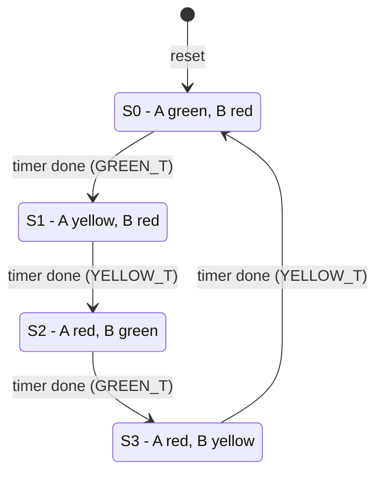

# FSM, Counter and Timing Documentation

## 1. Moore traffic light FSM

| State | Light A | Light B | Duration |
|---|---|---|---|
| S0 | Green 001 | Red 100 | GREEN_T |
| S1 | Yellow 010 | Red 100 | YELLOW_T |
| S2 | Red 100 | Green 001 | GREEN_T |
| S3 | Red 100 | Yellow 010 | YELLOW_T |

State encoding: binary (S0=00, S1=01, S2=10, S3=11). Odd states are yellow.

## 2. Mealy variant
Same states, plus input `emergency`. Output = f(state, emergency). When
emergency = 1: A = B = red immediately (combinational path), state and timer hold.

| | Moore | Mealy |
|---|---|---|
| Output depends on | state | state + input |
| Reaction to input | next clock edge (needs extra state) | same cycle |
| Glitch risk | low | input glitches reach outputs |

## 3. Counter sequences (truth / state tables)
| Counter | Reset | Sequence |
|---|---|---|
| Up 4-bit | 0000 | 0,1,2 ... 15,0 |
| Down 4-bit | 1111 | 15,14 ... 0,15 |
| Mod-10 | 0000 | 0 ... 9,0 |
| Ring | 0001 | 0001,0010,0100,1000 |
| Johnson | 0000 | 0000,0001,0011,0111,1111,1110,1100,1000 |

D flip-flop truth table (posedge clk): reset=1 -> Q=0; reset=0 -> Q=D.

## 4. Timing concepts (Exercise 5)
- Clock period T = 10 ns in the testbenches (100 MHz).
- Setup time: D must be stable at least t_su before the active clock edge.
- Hold time: D must stay stable at least t_h after the active edge.
- `tb_timing_demo` uses t_su = 2 ns, t_h = 1 ns:
  - D changes 3 ns before edge -> captured correctly.
  - D changes 1 ns before edge -> setup violation, Q = X.
  - D changes 0.5 ns after edge -> hold violation, Q = X.
- Async reset: Q clears immediately (no clock needed). Sync reset: Q clears on the next clock edge.
- Minimum clock period: T >= t_clk-to-q + t_logic + t_setup (+ skew).

## 5. Diagrams still to draw (draw.io / Excalidraw)
RTL block diagrams: D-FF, 8-bit register, shift register, counter_n, traffic light
(state register + timer + next-state logic + output logic), stopwatch
(FSM + tick divider + seconds counter + minutes counter).
Save PNGs in `docs/`. Add GTKWave screenshots in `docs/screenshots/`.
